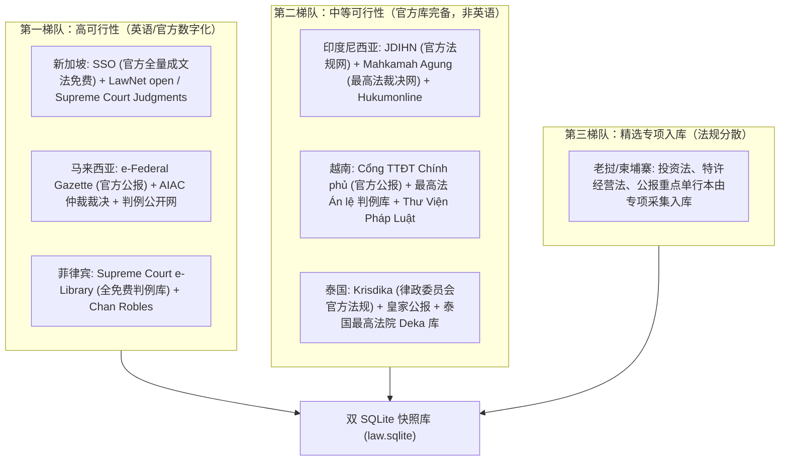
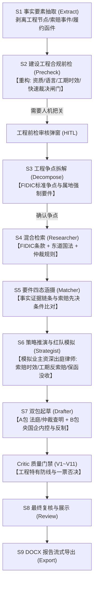

# 域外法查明智能工作台 (OverseasLawAssist)
# 东盟建设工程与出海基建投资法律合规支持方案

> **文件版本**：v1.0 (正式方案)  
> **制定日期**：2026-10-18  
> **适用对象**：中国出海基础设施建设领域国有企业与中央企业（中国建筑、中国中铁、中国铁建、中国交建、中国电建、中国能建、中信建设等及其海外子公司/项目部、涉外法务合规部与常年涉外法律顾问团队）  
> **核心领域**：东盟十国（重点涵盖印尼、越南、马来西亚、泰国、新加坡等）基础设施建设工程（EPC/BOT/PPP）与跨境投资并购（M&A/JV）全周期法律风险防范、合规指引与争议解决查明

---

## 目录

1. [执行摘要与战略转型定位](#一-执行摘要与战略转型定位)
2. [前端德美法域平滑屏蔽机制（无损隐藏与随需激活）](#二-前端德美法域平滑屏蔽机制无损隐藏与随需激活)
3. [东盟国家涉外建设工程与投资法律实务深度调研](#三-东盟国家涉外建设工程与投资法律实务深度调研)
   - 3.1 东盟十国通用法律特征与基建投资共性规则
   - 3.2 重点国别法律实务差异化剖析（法系、准入、资质、争议解决）
   - 3.3 需用户与业务方重点确认的事项清单（严守客观事实）
4. [东盟法条、判例与国际工程仲裁裁决获取可行性评估](#四-东盟法条判例与国际工程仲裁裁决获取可行性评估)
   - 4.1 东盟数据获取与德美法域权威法源的对比分析
   - 4.2 国别数据源分级与获取路径
   - 4.3 建设工程国际仲裁与 FIDIC 规则库数据集成
   - 4.4 多语种翻译对齐与小语种清洗管线
5. [基于当前架构的系统支持与改造扩展方案](#五-基于当前架构的系统支持与改造扩展方案)
   - 5.1 架构复用与继承（LangGraph推理流、双SQLite库、HybridRetriever）
   - 5.2 多法域层级与工程属性扩展（JurisdictionRegistry）
   - 5.3 工作流核心节点重构（S1~S9 建设工程化改造）
   - 5.4 质量门禁与防线核验升级（V1~V11 工程合规适配）
6. [针对出海基建央国企场景的专项新功能设计（补全当前缺失能力）](#六-针对出海基建央国企场景的专项新功能设计补全当前缺失能力)
   - 6.1 功能一：FIDIC 标准合同与专用条件（Particular Conditions）偏离审查与风险标红
   - 6.2 功能二：国别属地化强制性合规门禁检查器（资质、用工配额、本地化率TKDN）
   - 6.3 功能三：见索即付独立保函（On-Demand Bond）止付救济与防恶意索兑推演
   - 6.4 功能四：多语种（中-英-东南亚属地语）术语核验与三屏对照查明生成器
7. [实施路径规划、分期里程碑与验收标准](#七-实施路径规划分期里程碑与验收标准)

---

## 一、 执行摘要与战略转型定位

### 1.1 现状与转型背景
当前 [OverseasLawAssist](file:///C:/Downloads/OverseasLawAssist/ReadMe.md) 系统已圆满完成 Phase 1 至 Phase 6 的开发与验证，底层确立了**“三位一体分层协同架构”**，实现了针对**德国联邦法 (`de_federal`)** 与 **美国商事法 (`us_commercial`)** 的深度成文法解析、金标准先例拓扑网络检索、要件事实涵摄、胜败边界推演与最高院《涉外民事关系法律适用法解释（二）》标准文档导出。

然而，伴随“一带一路”高质量共建与中国基建产能出海，中国大陆出海基建的主力军——大型中央企业与地方国有企业在拓展东盟市场时，面临着与欧美跨国货物买卖完全不同的法律环境与严峻风险：
* **业务性质差异**：从单一的国际货物买卖合同（以 CISG、UCC Article 2、BGB 买卖篇为代表），转向资金规模巨大、周期漫长、履约变量极高、行政许可繁密的**重大基础设施投资并购与建设工程总承包（EPC/Turnkey/PPP/BOT/EPC+F）**；
* **法域环境异质**：东盟十国内部横跨英美法系、大陆法系、社会主义成文法体系及伊斯兰法/习惯法，法制成熟度、司法透明度、外资管制与政策变动性极度复杂；
* **痛点高度聚焦**：出海央国企痛点集中于**资质准入受限（BUJKA/JV要求）、土地特许经营权收回、工期延误与费用索赔（EOT & Additional Payment）、不可抗力与物价暴涨（Price Escalation）、属地化用工配额、本地化率要求（如印尼 TKDN）、外汇汇出受阻，以及境外业主恶意没收见索即付履约保函（Performance Bond）**。

因此，系统战略重心全面转型：**聚焦于东盟国家基础设施建设工程与跨境投资并购的法律风险防范与合规指引**，为央国企海外工程指挥部、出海法务团队、投标前风险评估委员会及代理争议解决的涉外律师提供机构级深度法律智能支撑。

---

## 二、 前端德美法域平滑屏蔽机制（无损隐藏与随需激活）

为满足业务转型需求，同时严格贯彻**“德美法域在前端暂时屏蔽但不删除，以后有需求支持可随时一键添加回来”**的架构要求，系统采用**“配置驱动型法域可见性门禁机制 (Feature-Flagged Jurisdiction Visibility)”**。

### 2.1 架构设计原则
1. **底层代码与模型资产 100% 完整保留**：
   * 后端 `lawagent/core/jurisdiction.py` 中 `de_federal` 与 `us_commercial` 的注册元数据保持不变；
   * 快照数据库 `data/snapshots/20261010-gii-v0.7/law.sqlite`（4,642 条德美成文法、27 篇金标准判例、119 条拓扑边）、FAISS 向量索引与 BM25 词法索引不做任何物理清理；
   * 后端所有检索路由、校准器与 28 项全量自动化测试（`tests/`）持续保持连通与绿灯状态；
2. **历史案件台账只读可溯**：
   * 既有已落盘的 C001~C004 等示范案件及历史德美法域案件，在案件列表与历史归档中保留只读查看权限与报告下载功能，确保审计追溯不受影响；
3. **前端录入与检索统一动态收敛**：
   * 仅在前端 UI 层的“新建案件选择器”、“域外法检索库法域筛选”以及“首页推荐引导”处对德美法域施加可见性过滤。

### 2.2 前端工程改造实现方案

#### 1. 前端法域配置文件定义 (`FrontEnd/src/configs/jurisdictions.ts`)
```typescript
export interface JurisdictionUIConfig {
  code: string;
  name_zh: string;
  category: 'asean' | 'legacy_western';
  is_active: boolean; // 控制是否在常规新建与检索 UI 中展示
  flag_icon?: string;
  description: string;
  supported_contract_types: string[];
}

export const JURISDICTION_REGISTRY: Record<string, JurisdictionUIConfig> = {
  // === 东盟法域（当前主推业务） ===
  asean_id: {
    code: 'asean_id',
    name_zh: '印度尼西亚工程与投资法',
    category: 'asean',
    is_active: true,
    description: '涵盖建筑服务法(UU 2/2017)、综合性创造就业法、BUJKA资质、TKDN本地化率、外商投资负面清单',
    supported_contract_types: ['EPC总承包合同', 'BOT/PPP特许经营协议', '股权收购协议(SPA)', '联营体合作协议(JO/JV)']
  },
  asean_vn: {
    code: 'asean_vn',
    name_zh: '越南建设与投资法',
    category: 'asean',
    is_active: true,
    description: '涵盖建筑法(Law 50/2014)、投资法(Law 61/2020)、PPP法(Law 64/2020)、外国承包商许可证、招标与土地法',
    supported_contract_types: ['EPC交钥匙合同', 'PPP特许权协议', '境外分包合同', '项目公司合资协议']
  },
  asean_my: {
    code: 'asean_my',
    name_zh: '马来西亚建设与投资法',
    category: 'asean',
    is_active: true,
    description: '涵盖普通法系判例、CIDB资质体系、CIPAA快速工程款裁决、土著配额(Bumiputera)及外汇管制',
    supported_contract_types: ['FIDIC合同', 'PAM/PWD标准工程合同', '基础设施投资与回购协议']
  },
  asean_sg: {
    code: 'asean_sg',
    name_zh: '新加坡建设与商事仲裁法',
    category: 'asean',
    is_active: true,
    description: '涵盖普通法系最高裁判、SOPA快速工程款支付裁决、SIAC/SICC仲裁管辖、国际总承包争议防线',
    supported_contract_types: ['国际EPC工程总包合同', '境外工程保函纠纷', '跨境投资争议解决协议']
  },
  asean_th: {
    code: 'asean_th',
    name_zh: '泰国工程与外商投资法',
    category: 'asean',
    is_active: true,
    description: '涵盖外商经营法(FBA)、民商法典雇佣与承揽编、BOI投资优惠、PPP法与工程执业限制',
    supported_contract_types: ['EPC总承包合同', '合资经营协议', '特许经营权转让协议']
  },

  // === 欧美存量法域（暂时屏蔽，保留随时恢复接口） ===
  de_federal: {
    code: 'de_federal',
    name_zh: '德国联邦法 (成文法系)',
    category: 'legacy_western',
    is_active: false, // 🔴 前端常规界面屏蔽
    description: '德国民法典(BGB)、商法典(HGB)、有限责任公司法(GmbHG)、联邦最高法院判例',
    supported_contract_types: ['国际货物买卖合同', '机械工业设备采购合同']
  },
  us_commercial: {
    code: 'us_commercial',
    name_zh: '美国商事与联邦法 (普通法系)',
    category: 'legacy_western',
    is_active: false, // 🔴 前端常规界面屏蔽
    description: '统一商法典(UCC Article 2)、特拉华公司法(DGCL)、联邦仲裁法(FAA)、28 U.S.C. §1782',
    supported_contract_types: ['跨国买卖合同', '商事仲裁协议', '跨境取证审查']
  }
};

/** 全局配置开关：可通过本地 Storage 或后台环境变量快速激活存量法域展示 */
export const SHOW_LEGACY_WESTERN_JURISDICTIONS = false;

export function getActiveJurisdictions(): JurisdictionUIConfig[] {
  return Object.values(JURISDICTION_REGISTRY).filter(
    j => j.is_active || SHOW_LEGACY_WESTERN_JURISDICTIONS
  );
}
```

#### 2. 前端受影响组件改造清单与屏蔽位置
* **[CaseEntryModal.tsx](file:///C:/Downloads/OverseasLawAssist/FrontEnd/src/components/cases/CaseEntryModal.tsx)**：
  * 原硬编码状态 `const [jurisdiction, setJurisdiction] = useState<'de_federal' | 'us_commercial'>('de_federal');` 重构为基于 `getActiveJurisdictions()` 动态渲染；
  * 默认初始选择切换为 `asean_id`（印尼工程与投资法）；
  * 移除德意志国旗与美联邦徽章卡片，替换为东盟各重点国国旗与工程资质特征标签；
* **[NormSearchEngineView.tsx](file:///C:/Downloads/OverseasLawAssist/FrontEnd/src/components/search/NormSearchEngineView.tsx)**：
  * 顶部法域过滤器下拉菜单仅展现激活的东盟法域及综合工程规约；
  * 当用户搜索历史案件或输入特定代码如 `UCC` 或 `BGB` 时，系统提示“属于存量归档法库，已默认隐藏；可通过高级设置开启检索”；
* **随需一键恢复机制**：
  * 只需将 `SHOW_LEGACY_WESTERN_JURISDICTIONS` 设置为 `true`，德美法域的卡片、预设示范案例及检索入口立即 100% 原样恢复，实现零返工、零风险。

---

## 三、 东盟国家涉外建设工程与投资法律实务深度调研

> **实务调研原则**：恪守法律客观实务与工程司法管辖实践，**严禁虚构法律条文与判例**，对各法域具有实效的成文法规与司法惯例进行严谨对照，并对中国涉外司法和跨境仲裁的关键交叉点做明确区分。

```
┌────────────────────────────────────────────────────────────────────────┐
│              东盟涉外基础设施工程与投资并购法律体系全景图              │
├────────────────────────────────────────────────────────────────────────┤
│ 【东盟区域顶层条约】                                                  │
│  - RCEP (区域全面经济伙伴关系协定) 投资与政府采购章节                 │
│  - ACIA (东盟全面投资协定) / 双边投资保护协定 (BITs)                  │
├───────────────────────────────────┬────────────────────────────────────┤
│ 【普通法系 (Common Law)】         │ 【大陆法系 / 社会主义成文法系】   │
│  - 新加坡 (Singapore)             │  - 印度尼西亚 (Indonesia)          │
│  - 马来西亚 (Malaysia)            │  - 越南 (Vietnam)                  │
│  - 文莱 (Brunei)                  │  - 泰国 (Thailand)                 │
│  - 菲律宾 (Philippines - 混合制)  │  - 柬埔寨 (Cambodia) / 老挝 (Laos) │
├───────────────────────────────────┴────────────────────────────────────┤
│ 【工程主合同范本与准据法交互】                                        │
│  - 国际工程通用底座: FIDIC (银皮书 EPC / 黄皮书 D&B / 红皮书 Construction)│
│  - 强制性属地法限制 (Lex Loci Constructionis): 资质准入/用工配额/土地/外汇 │
└────────────────────────────────────────────────────────────────────────┘
```

### 3.1 东盟十国通用法律特征与基建投资共性规则（通用点）

在为中国出海基建央国企提供跨境合规指引与争议防范时，东盟十国呈现出以下八大具有普遍约束力的共性法律特征：

1. **工程合同广泛以 FIDIC 范本为骨架，但受属地强制性法（Lex Loci）绝对优先制约**：
   * 无论是世行（WB）、亚行（ADB）、亚投行（AIIB）等多边金融机构贷款项目，还是中资两优贷款（优惠出口买方信贷/优贷）或商业 EPC 项目，东盟地区最通用的合同文本均为 FIDIC（特别是 1999 年版及 2017 年版 Silver Book 银皮书和 Yellow Book 黄皮书）；
   * **但通用条件中约定的意思自治条款，一律受东道国强制法（Imperative Provisions）压制**。若 FIDIC 专用条件约定的责任限制或工期失效条款违背了东道国公共秩序（如建筑主体结构最低法定质量保修期、安全生产强制标准），则该约定在属地法院自始无效。
2. **土地所有权对外资普遍实施宪法级“所有权封锁”**：
   * 东盟绝大多数国家（除极个别离岸金融区或特殊高层公寓分层产权 Strata Title 外）在宪法或土地基本法中明确规定：**外国自然人与外资控股企业绝对严禁拥有永久土地所有权（Freehold）**；
   * 基建与投资项目必须依赖**长期土地租赁权（Leasehold）**或**政府特许经营使用权（Concession / Right of Use）**，如印尼的建筑权（HGB / Hak Guna Bangunan）、使用权（HP / Hak Pakai），越南的土地租赁权（LUR / Land Use Right Certificate），泰国的长期土地租约（最长30年+续期30年）；
   * **征地拆迁迟延（Right of Way / Site Handover Delay）是导致工期索赔的第一大风险诱因**。
3. **严苛的外国承包商资质牌照准入与属地联营体（Joint Operation）强制**：
   * 外国基建企业不得直接持中国母公司营业执照进入东盟进行工程施工，必须在东道国办理**外国承包商代表处（Representative Office）**或注册**外资项目公司（PT PMA / FIE）**；
   * 且普遍强制要求**与东道国本土具备顶级资质的本国承包商组建联合体（JO / KSO / Consortium）**，并对中资企业的实际施工份额和项目经理资质设置刚性门槛。
4. **劳工保护主义与外籍用工严苛配额（Localization of Workforce）**：
   * 东盟各国普遍立法保护本土劳工就业，对中国施工技术人员、管理团队派驻实施“岗位保留目录”与外籍劳工配额管理；
   * 严禁成规模引入中方普通劳务工人（普工必须100%属地化招聘），仅允许关键岗位工程师与高级管理人员办理工作许可（如印尼 RPTKA/IMTA、泰国 Alien Work Permit、越南外籍劳工工作许可证）；
   * 强制缴纳属地法定社会保险（如印尼 BPJS、马来西亚 SOCSO/EPF、越南 SI/HI/UI）。
5. **见索即付独立保函（Demand Guarantee / Performance Bond）的欺诈索兑高危**：
   * 业主要求由国际知名银行或东道国一类商业银行开立无条件独立保函（投标保函、预付款保函、履约保函、质保金保函），遵循 URDG 758 惯例；
   * 实践中，境外业主在面临工期争议或政治换届时，极易发起“恶意索兑”作为施压杠杆；而在东道国法院申请**保函止付令（Injunction / Temporary Restraining Order）**面临极高的证明标准（必须证明明显欺诈 Fraud 或显失公平 Unconscionability），极易造成中资央企巨额现金流流失。
6. **外汇管制、跨境资金结汇与资本项目出境审查**：
   * 除新加坡资本完全自由流动外，其他东盟国家均存在不同程度的外汇监管：如越南国家银行（SBV）对中长意外债的强制登记与利息汇出审查、印尼央行关于天然资源与基建项目出口收益在境内留存（DHE SDA）的要求、泰国关于泰铢账户结算兑换申报规程，以及老挝、缅甸极度严格的官方外汇配额管制。
7. **环境与社会影响评价（EIA/ESIA）及社区利益冲突**：
   * 重大交通、能源（水电/火电/光伏）、矿山基建项目必须取得东道国环保部的 EIA 批文（如印尼 AMDAL、越南 DTM、泰国 EIA）；
   * 环评手续的拖延、环保 NGO 的司法阻击、以及属地原住民/部落土地权益抗争，是项目前期停工违约的高发区。
8. **争议解决普遍采用国际商事仲裁，但属地法院司法审查存在阻碍**：
   * 中资央企标准合同普遍约定仲裁条款，主流管辖机构为**新加坡国际仲裁中心（SIAC）**、国际商会仲裁院（ICC）、香港国际仲裁中心（HKIAC）或中国国际经济贸易仲裁委员会（CIETAC）；
   * 东盟十国均为 1958 年《承认及执行外国仲裁裁决公约》（《纽约公约》）缔约国；
   * 但在仲裁裁决裁决返回东道国（如印尼、越南）执行时，常遭遇当地被执行人以“违背本国公共秩序（Public Policy）”或“送达程序瑕疵”为由提起的撤销与不予执行抗辩。

---

### 3.2 重点国别法律实务差异化剖析（不同点）

为防止方案空泛，本节深度提炼出海基建业务量最大的五个东盟核心国家的法律实务差异：

| 维度 | 印度尼西亚 (Indonesia) | 越南 (Vietnam) | 马来西亚 (Malaysia) | 新加坡 (Singapore) | 泰国 (Thailand) |
| :--- | :--- | :--- | :--- | :--- | :--- |
| **法系属性** | 大陆法系（受荷兰罗马-法兰西法影响） + 习惯法(Adat) + 伊斯兰法 | 社会主义成文法系 + 民法典体制 | 普通法系（英美法体系，遵循先例原则） | 普通法系（顶级法治完备度，遵循先例） | 大陆法系（受欧陆法典与日本法影响的民商法典） |
| **主要工程法典** | 《建筑服务法》(UU 2/2017)；《创造就业综合法》(UU 6/2023)；民法典(KUHPerdata) | 《建设法》(Law 50/2014, amended 62/2020)；《民法典》(2015)；《招标法》(2023) | 联邦普通法；《建设工程行业付款与快速裁决法》(CIPAA 2012)；CIDB法案(Act 520) | 基础普通法；《建筑业付款与安全法》(SOPA Cap 30B)；BCA法规 | 《民商法典》(CCC)雇佣与承揽编；《建筑控制法》(1979)；《工程行业法》 |
| **外国施工实体准入形式** | 设立 BUJKA 代表处（必须与本土顶级大企业组成联营体 KSO）或设立合资 PT PMA | 按单项工程申请“外国承包商许可证”(Giấy phép hoạt động xây dựng)，强制联营/分包 | 设立本国公司或注册外国分支机构，必须在 CIDB 取得 G7 级无限制施工资质 | 取得 BCA (建筑工程局) CRS 资质分级注册（A1/A2级方可投标特大型政府公建） | 申请《外商经营许可证》(FBL)，承揽被列入 List 3 的工程；或取得 BOI 投资特权 |
| **合同语言强制性规定** | **【重大致命风险】** 依据 2009 年第 24 号法及 2019 年 63 号总统令，涉及印尼实体的合同**必须包含印尼语文本**，否则司法判决可能导致合同**被认定为自始无效**！ | 依据招标法与行政管理规章，向政府报备和公开招标的工程合同必须使用越南语 | 无强制，官方与商事普遍通行英语（English），极具确定性 | 英语为唯一法定与司法审判语言，商业确定性全球最高 | 涉政府工程及土地备案必须有泰语文本；涉外私营工程可使用双语，有争议以泰文为准 |
| **工程款快速法定裁决 (Statutory Adjudication)** | **无**。工程款纠纷只能通过漫长的法院诉讼或 BANI 仲裁解决 | **无**。只能通过 VIAC 仲裁或越南属地人民法院审理 | **具备 CIPAA 强制制度**。“先付款，后争议”，法定严苛答辩期限，拒付直接向高院强制执行 | **具备 SOPA 强制制度**。极度严格的付款响应期（Payment Response），失权极快，裁决执行力极强 | **无**。通过仲裁（TAI/THAC）或行政/司法法院审理 |
| **本地化率 / 配额考核** | **TKDN 本地成分率**：基建与设备供货中，强制考核本土原材料与工时比例，达不到面临罚款或违约解约 | **本土分包强制**：外国总承包商必须承诺将法定比例的工程量分包给越南本土企业 | **Bumiputera (土著配额)**：政府公建与特许经营项目中，强制要求土著股权或不低于 30% 分包 | 无歧视性配额限制，完全遵循公开透明市场化采购规则 | 对受限行业有泰籍股权比例（通常为 51%）与泰籍员工配比强制要求 |
| **境外仲裁执行与司法干预** | 属地法院干预较多，被执行人常以“公共秩序”抗辩阻击执行；印尼民事诉讼法程序冗长 | 依据民事诉讼法第 459 条审查外国裁决，不予承认执行率在东盟处于较高水位 | 高院支持仲裁，严格遵循纽约公约，对纽约公约裁决执行顺畅 | 国际仲裁枢纽，高院极度尊重仲裁自治，撤裁门槛极高，执行效率居世界顶级 | 中央知识产权与国际贸易法院（IP&IT Court）审理，普遍遵守纽约公约但审限较长 |

---

### 3.3 需用户与业务方重点确认的事项清单（严守客观事实）

为确保东盟法域扩展完全契合出海央国企的实操诉求，在后续具体实施前，**必须由业务主管方与涉外法务团队确认以下 4 项核心实务问题**：

* [ ] **确认项 1：首期落地的具体国别优先级排序**
  * *问题*：东盟十国法律制度分散，首批法域扩充是优先覆盖“**印尼、越南、马来西亚、新加坡、泰国**”五国，还是需将“老挝”（中老铁路及大型水电特许权密集）、“柬埔寨”（路桥及金边/西港工业园）列入第一梯队？
  * *实务背景*：不同国家的法条采集与判例数字化程度差距极大，分梯队攻坚可大幅缩短交付周期。
* [ ] **确认项 2：央国企出海的核心主导业务模式定位**
  * *问题*：系统应以**纯施工工程总承包（传统 EPC / FIDIC 银皮书交钥匙）**为主攻方向，还是必须深度支持**投建营一体化（PPP / BOT 特许经营 / 股权并购 M&A + EPC+F）**？
  * *实务背景*：若侧重传统 EPC，核心在于工期变更、缺陷责任期与保函止付；若侧重 PPP/BOT，则必须额外涵盖主权担保效力、特许权提前终止补偿、电价/通行费调整机制及特许权协议合法性审查。
* [ ] **确认项 3：法条原文语种与释义翻译的展现策略**
  * *问题*：系统在出具查明结论与法条证据时，对于印尼、越南、泰国等非英语国家：
    * 模式 A（推荐）：提供“**属地官方原文（印尼语/越南语/泰语） + 经司法认证的官方/半官方英文译本 + 针对中国法官/法务的中文专业意译**”三语对照？
    * 模式 B：仅提供“官方英文译本 + 中文意译”？
  * *实务背景*：印尼最高法院曾以“非官方印尼语文本无效”为由推翻仲裁条款，保留属地原文是抵御程序异议的最高防线。
* [ ] **确认项 4：合同基准是否全面绑定 FIDIC 核心条款库**
  * *问题*：系统是否同意将 FIDIC 1999/2017 银皮书（EPC）与黄皮书（D&B）的通用条件（General Conditions）作为系统默认的内建合同基准知识库，并通过该基准自动化比对各项目的“专用条件（Particular Conditions）”？
  * *实务背景*：在实际签约中，境外业主往往在专用条件中大肆削减承包商索赔权利（如将 28 天通知期限缩短为 7 天、删除雇主延误补偿），绑定 FIDIC 基准可实现一键秒级识别“霸王条款”。

---

## 四、 东盟法条、判例与国际工程仲裁裁决获取可行性评估

### 4.1 东盟数据获取与德美法域权威法源的对比分析

系统在前期实施德国法与美国法时，高度依赖于官方结构化且免费公开的数据集市（如德国司法部 *Gesetze im Internet* 提供的无偿全量 XML Zip 包，以及美国非营利组织 Free Law Project 维护的 *CourtListener* 免费实时 REST API）。

在东盟国家，法源获取的生态具有**高度异质性与碎片化**：
1. **新加坡、马来西亚**：法治数字化程度极高，成文法典全量免费开放，但顶级民商事判例库（如新加坡 LawNet、马来西亚 CLJ）属于商业收费生态；
2. **印尼、越南、泰国**：成文法律法规有政府集中公报平台（JDIH、Thư Viện Pháp Luật、Krisdika），可免费或低成本抓取，但多为 PDF 扫描件或排版松散的 HTML，需重构解析清洗管线；其法院判例非遵循先例法（除越南自 2016 年起正式发布的最高法权威 Án lệ 判例外），司法审判文书检索价值不如德美判例直观；
3. **老挝、柬埔寨**：官方数据源依赖国际援建项目（如世界银行资助的 Lao Official Gazette），数字化尚在推进中。

### 4.2 国别数据源分级与获取路径



#### 国别数据源深度详表：
* **新加坡 (Singapore)**：
  * **官方法规源**：[Singapore Statutes Online (SSO)](https://sso.agc.gov.sg/)。新加坡总检察署官方运营，提供完全免费、包含全部历史修订沿革、结构极其严整的 HTML/XML 成文法；
  * **重点法典**：Building and Construction Industry Security of Payment Act (SOPA, Cap 30B)、Civil Law Act、Arbitration Act、International Arbitration Act；
  * **判例源**：新加坡最高法院官网公开裁判文书及 Singapore Law Watch (SLW) 每日要讯。
* **马来西亚 (Malaysia)**：
  * **官方法规源**：[Federal Legislation Portal (LOM / AGC)](https://lom.agc.gov.my/)。总检察署联邦法典在线，提供所有现行有效法令（Acts of Parliament）；
  * **重点法典**：Construction Industry Payment and Adjudication Act 2012 (CIPAA)、Lembaga Pembangunan Industri Pembinaan Malaysia Act 1994 (Act 520)、Contracts Act 1950；
  * **判例与仲裁源**：司法机构门户网站公开之联邦法院（Federal Court）与上诉法院（Court of Appeal）裁决，以及 AIAC（亚洲国际仲裁中心）公开实务汇编。
* **印度尼西亚 (Indonesia)**：
  * **官方法规源**：[JDIHN (Jaringan Dokumentasi dan Informasi Hukum Nasional)](https://jdihn.go.id/) 及最高审计署法律网 [BPK Peraturan](https://peraturan.bpk.go.id/)。全免费收录自 1945 年至今所有法律（UU）、政府条例（PP）、总统令（Perpres）与部门规章（Permen）；
  * **重点法典**：UU No. 2 Tahun 2017 (建筑服务法)、UU No. 6 Tahun 2023 (创造就业综合法)、KUHPerdata (民法典承揽与合同编)、UU No. 24 Tahun 2009 (国旗语言法律)；
  * **判例与裁判源**：最高法院判决系统 [Mahkamah Agung Putusan](https://putusan.mahkamahagung.go.id/)，可检索海量涉外工程与合同违约判例。
* **越南 (Vietnam)**：
  * **官方法规源**：[越南政府门户信息网 (Cổng TTĐT Chính phủ)](https://chinhphu.vn/) 及全国法律数据库系统；
  * **重点法典**：Luật Xây dựng (建设法 2014/2020)、Luật Đầu tư (投资法 2020)、Luật Đầu tư theo phương thức đối tác công tư (PPP法 2020)、Bộ luật Dân sự (民法典 2015)、Luật Đấu thầu (招标法 2023)；
  * **判例与裁判源**：最高人民法院判例门户 [Tòa án nhân dân tối cao - Án lệ](https://anle.toaan.gov.vn/)，收录国家审判委员会公开推荐的权威裁判指引（涵盖建设合同违约、工期延误利息及保证纠纷）。
* **泰国 (Thailand)**：
  * **官方法规源**：[泰国律政委员会 (Office of the Council of State / Krisdika)](https://www.krisdika.go.th/)，官方发布全量现行有效成文法泰文全本及部分重要涉外法律官方英文译本；
  * **重点法典**：Civil and Commercial Code (民商法典雇佣与承揽编)、Foreign Business Act B.E. 2542 (外商经营法)、Public-Private Partnership Act B.E. 2562 (PPP法)。

### 4.3 建设工程国际仲裁与 FIDIC 规则库数据集成
除了主权国家的成文法典外，**国际工程争议的最核心裁判渊源来自标准合同条款解释与国际仲裁裁决**：
1. **FIDIC 金标准知识库预制**：
   * 将 FIDIC 1999 及 2017 版 Red Book、Yellow Book、Silver Book 官方 20/21 条全部条目完成结构化切分，重点标注：
     * Clause 20.1 / 20.2 承包商索赔程序与 28 天失权通知门禁（Time-Bar）；
     * Clause 8.4 / 8.5 工期延长（EOT）法定事由；
     * Clause 13 工程变更与调价公式；
     * Clause 4.2 履约保函的开立、延期与退还；
     * Clause 17/18/19 风险划分与免责例外事件（Exceptional Events）；
2. **权威工程法教科书与行业标准入库**：
   * 引入国际公认的英国工程法学会《延迟与中断工期分析准则》(SCL Delay and Disruption Protocol) 核心要素；
   * 引入国际商事仲裁经典工程争议裁判规则（如针对 Prevention Principle 业主阻碍原则、Concurrent Delay 并存延误评判标准）。

### 4.4 多语种翻译对齐与小语种清洗管线
* **多语种混合分词器升级**：在当前 `lawagent/store/compound.py` 基础上扩展，增加小语种预处理：
  * 印尼语词干还原（基于 Sastrawi 算法或通用多语言 Lemmatizer）；
  * 越南语分词切块（基于 PyVi 工具）；
  * 英文分词则完全继承成熟方案；
* **三层术语词库 (Glossary) 映射表**：
  * 在 `kb/asean/glossary.csv` 中建立涵盖 **中文专业工程术语 ➔ 英文 FIDIC 国际工程术语 ➔ 东南亚属地法定概念**（例如：“工程接收证书 TOC” ➔ "Taking-Over Certificate" ➔ 印尼语 "Serah Terima Pertama (PHO)" ➔ 越南语 "Biên bản nghiệm thu bàn giao"）。

---

## 五、 基于当前架构的系统支持与改造扩展方案

系统具备极高的解耦性与工程扩展性。本节明确定义**如何复用当前技术资产**，以及**如何针对东盟工程法域进行升级改造**。

### 5.1 架构复用与继承（Keep What Works）

```
[当前系统成熟底座: 100% 继承复用]
├── 1. LangGraph 确定性状态图流水线 (StateGraph + MemorySaver 全异步驱动)
├── 2. 双 SQLite 数据库物理隔离 (只读快照库 law.sqlite + 读写运行库 state.sqlite)
├── 3. 受约束混合检索器 (BM25 词法 + BGE-M3 FAISS 向量 + 知识图谱扩展 + 重排)
├── 4. 异构双模型决策架构 (主推理模型生成 + 裁判模型执行质量门禁)
├── 5. 司法合规双包报告导出 (A包查明文本 + B包咨询策略，DOCX 流式生成器)
└── 6. React 19 + Tailwind 前端交互体系 (全景时间轴 + 动态攻防看板 + 实时 SSE 广播)
```

### 5.2 多法域层级与工程属性扩展（JurisdictionRegistry）

重构 `lawagent/core/jurisdiction.py`，支持**国家与业务领域双重标签**，并拓展东盟多法域注册：

```python
# lawagent/core/jurisdiction.py 扩展设计

@dataclass
class JurisdictionMetadata:
    code: str                         # 如 'asean_id', 'asean_vn', 'asean_my'
    country_code: str                 # 'ID', 'VN', 'MY', 'SG', 'TH'
    country_name_zh: str              # '印度尼西亚', '越南', '马来西亚'
    legal_family: str                 # 'civil_law', 'common_law'
    domain: str                       # 'construction_and_investment'
    name_zh: str                      # '印度尼西亚建设工程与投资法'
    primary_language: str             # 'id', 'vi', 'en'
    secondary_language: str           # 'en'
    citation_standard: str            # 'uu_indonesia', 'vietnam_law', 'bluebook'
    default_laws: List[str] = field(default_factory=list)
    has_statutory_adjudication: bool = False # 是否具备 SOPA/CIPAA 快速裁决
    contract_language_mandatory: bool = False # 是否强制属地语言文本
    enabled_in_ui: bool = True       # 控制前端是否默认展示
```

### 5.3 工作流核心节点重构（S1~S9 建设工程化改造）

对 `lawagent/flow/nodes.py` 与 `lawagent/flow/graph.py` 进行针对性增强：



#### 各节点深度改造细化：
1. **S1: Extract 节点适配建设工程事实要素**：
   * 自动识别建设工程专有事实槽位：`中标与合同签订日`、`开工令下达日 (Commencement Date)`、`基准日期 (Base Date)`、`关键路径延误事件 (Critical Path Delay)`、`索赔意向通知日 (Notice of Claim within 28 days)`、`详细索赔账目报送日 (Detailed Claim Report)`、`工程师答辩核定日 (Engineer's Determination)`、`保函到期与索兑时点 (Bond Expiry & Call)`；
2. **S2: Precheck 节点彻底重构（废弃 CISG，替换为工程四大闸门）**：
   * **彻底移除或有条件跳过 CISG 闸门**：依据联合国《国际货物销售合同公约》第 3 条第 2 款，建设工程与劳务占主要地位的合同**依法完全不适用 CISG**；在东盟工程法域下，默认设置 `cisg_excluded = true` 并自动旁路跳过；
   * **新增 1：外国承包商资质合规闸门 (Licensing Gate)**：检测承包商是否在东道国取得 BUJKA / 建设资格许可证，联营体是否满足外资股比限制；
   * **新增 2：合同语言效力闸门 (Language Validity Gate)**：针对印尼案件，核查合同是否存在官方印尼语版本；未提供时直接亮起**红色致命风险灯**，警示合同有被印尼法院推翻无效的极端判例；
   * **新增 3：法定快速工程款裁决时效闸门 (CIPAA/SOPA Gate)**：针对新马案件，核验是否在收到付款凭证后法定天数内发出有效付款响应（Payment Response）；
   * **新增 4：FIDIC 索赔前置时效闸门 (28-day Notice Bar Gate)**：核实从承包商知悉延误事件至发出首封索赔意向书是否超过 28 天；
3. **S3: Decompose 节点新增工程与投资专属模板库**：
   * 预制六大高频工程争议模板（置于 `kb/asean/templates/`）：
     * `eot_delay_claim.yaml`：工期延长（EOT）与业主延误赔偿（涵盖征地移交迟延、地质恶劣、恶劣气候、变更指令）；
     * `price_escalation_force_majeure.yaml`：大宗建材暴涨、汇率暴跌调价与不可抗力免责；
     * `performance_bond_injunction.yaml`：业主恶意索兑履约保函与紧急仲裁员/法院临时止付裁定；
     * `variation_order_dispute.yaml`：无书面指令下口头指示施工之工程量增减确认与结算；
     * `contract_termination_takeover.yaml`：业主违规没收现场、单方终止合同与特许权国有化征收；
     * `defect_liability_retention.yaml`：缺陷责任期满拒绝签署移交证书与扣留质保金（Retention Money）；
4. **S6: Strategist 红队攻防模拟工程大律师对抗**：
   * 扮演境外业主与监理工程师的对抗视角，针对我方索赔发起致命反击：
     * **反击点 1（时效抗辩）**：“承包商未在 28 天内提交书面索赔意向，依据 FIDIC 第 20.1 条已发生不可撤销的权利放弃（Waiver of Rights）”；
     * **反击点 2（工期延误反索赔）**：“主张非关键路径延误，且存在承包商自身人员设备不到位导致的并存延误（Concurrent Delay），反向扣索工期延误违约金（Delay Liquidated Damages, DLD）”；
     * **反击点 3（保函没收威胁）**：“直接向开证行发出 Demand Letter，全额索兑 10% 履约保函与 10% 预付款保函残值”；
   * **我方反制盾牌库**：
     * 援引业主阻碍原则（Prevention Principle）主张工期时效处于开放状态（Time at Large），违约金条款失效；
     * 举证监理工程师实质性参与协调或在会议纪要中自认延误，构成“禁反言（Estoppel）”阻却 28 天失权；
     * 依据东道国法律证明业主明知自身违约仍索兑保函构成欺诈，向仲裁庭申请临时措施或向法院申请止付令。

### 5.4 质量门禁与防线核验升级（V1~V11 工程合规适配）

对 `lawagent/flow/critic.py` 实施适配性调整：
* **V4 时点红黄两态规则扩展**：除了关注法典修订，重点核查**项目基准日（Base Date，投标截止日前 28 天）与东道国法律变更（Change in Legislation）**，若东道国在基准日之后出台新税法、上调最低工资标准或环保要求，属于依法享有费用调增与工期顺延的事项；
* **V5 规则改造**：由旧版货物买卖“CISG 闸门”升级为**“工程属地强制法排他性与管辖权门禁”**；
* **V8 客观中立防线持续恪守**：坚决禁止给出“工期索赔 100% 成立”或“保函必定止付成功”等盲目乐观结论，必须以严密的假设条件推演呈现（“在仲裁庭认定业主迟延移交场地构成关键路径阻碍、且承包商会议纪要构成有效默示通知的前提下，倾向于支持顺延工期 X 天”）。

---

## 六、 针对出海基建央国企场景的专项新功能设计（补全当前缺失能力）

针对中国出海工程央国企的实务痛点，当前系统尚不支持、但**在东盟工程转型中必须重点扩展建设**的四大专业功能模块如下：

```
┌────────────────────────────────────────────────────────────────────────┐
│             出海央国企建设工程与投资专属新增四大核心功能               │
├───────────────────────────────────┬────────────────────────────────────┤
│ 1. FIDIC 专用条件风险对比器       │ 2. 属地化资质与用工合规穿透自检    │
│    (Particular Conditions Risk)   │    (Local Compliance Checker)      │
│    - 自动比对银皮书/黄皮书基准    │    - BUJKA / 联营体股比自动核算    │
│    - 识别苛刻缩减索赔期限/无限责任│    - 印尼 TKDN 本地化率合规评估    │
├───────────────────────────────────┼────────────────────────────────────┤
│ 3. 独立履约保函恶意索兑止付沙盘   │ 4. 三语对照查明意见书生成器        │
│    (Bond Injunction Assessment)   │    (Trilingual Dossier Generator)  │
│    - 欺诈例外与显失公平心证推演   │    - 属地官方语言(印尼/越/泰)+英文 │
│    - 属地法院/紧急仲裁员止付策略  │    - 满足央企境外重大决策报告规范  │
└───────────────────────────────────┴────────────────────────────────────┘
```

### 6.1 功能一：FIDIC 标准合同与专用条件（Particular Conditions）偏离审查与风险标红
* **痛点场景**：境外业主在招标文件中，往往表面采用 FIDIC 银皮书，但在“专用条件（Part B / Particular Conditions）”中进行大幅修改，悄悄删去通用条件赋予承包商的保护性条款（如将雇主免责扩大、将延误通知从 28 天压缩为 7 天、规定哪怕由于业主原因停工也不补偿窝工费和利润、规定承包商对未预见的地下地质风险承担无限全责）；
* **功能实现**：
  * 用户上传或粘贴合同专用条件条款文本；
  * 系统自动提取对应条款编号，与内置的 **FIDIC 官方金标准通用条件（General Conditions）** 进行 Diff 对比；
  * 标记**红（高危不可接受/一票否决建议）、黄（中度风险需设置对冲机制）、绿（正常商事偏离）**三级警示，并给出符合中国央企海外风险防范标准的修改建议条文（Counter-Drafting Language）。

### 6.2 功能二：国别属地化强制性合规门禁检查器（资质、用工配额、本地化率TKDN）
* **痛点场景**：基建央企在中标后，常因疏于属地行政合规导致巨额行政罚款、甚至被东道国工程部查封停工；
* **功能实现**：
  * **资质与牌照审查**：自动核验是否持有有效 BUJKA 证书、SBU 类别是否涵盖投标工程标的、合作印尼本土公司是否为具备资格的“BUJK Besar”；
  * **TKDN 本地化率穿透**：根据项目工程设备采购清单，自动对照印尼工业部最新 TKDN 规范，测算本地自制率预期百分比，提示设备从中国直运清关可能触发的违约罚则；
  * **印尼合同语言合规审查**：一键检测主合同与附件是否存在印尼语签字版本，若无，自动生成专项风险提示与追溯补签印尼语版本的法律实务备忘录。

### 6.3 功能三：见索即付独立保函（On-Demand Bond）止付救济与防恶意索兑研判模块
* **痛点场景**：发生工期延误争议或业主资金链断裂时，业主往往直接向国际开证行发出即期兑付索赔通知，银行基于“独立抽象原则”即刻付款，导致央企面临无法弥补的资金损失；
* **功能实现**：
  * **索兑合规性形式审查**：核验业主的索兑通知书是否严格满足保函正文约定的单据格式、声明内容、递交方式及有效授权（Strict Compliance 原则）；
  * **止付令可行性心证推演 (Injunction Viability)**：
    * 新加坡法域：评估是否满足 JBE Properties 案确立的“显失公平（Unconscionability）”证明标准；
    * 马来西亚法域：评估是否满足 Sumatec 案确立的欺诈或显失公平门槛；
    * 国际仲裁：评估向 SIAC / ICC 申请**紧急仲裁员（Emergency Arbitrator）临时禁令**的胜算与操作窗口期；
  * 输出保函止付实操动作清单与紧急保全申请法律文本框架。

### 6.4 功能四：多语种（中-英-东南亚属地语）术语核验与三屏对照查明生成器
* **痛点场景**：央国企向董事会、国资委汇报或呈递涉外仲裁庭时，语言混乱易导致决策误判或裁判不予采信；
* **功能实现**：
  * 在查明报告导出与预览界面，支持**属地官方原文（印尼语/越南语/泰语等）、国际商事英文译本与中文法律释义**三语段落级并排对齐；
  * 报告直接对齐中国出海央企“三重一大”涉外法律合规审查规范与《最高人民法院关于适用〈涉外民事关系法律适用法〉若干问题的解释（二）》第三条权威格式，支持一键导出包含完备水印、红线标记与免责声明的专业 DOCX 法律意见书。

---

## 七、 实施路径规划、分期里程碑与验收标准

系统东盟工程法域转型升级共规划为四个演进阶段：

```
2026 Q4 里程碑规划路线图
┌─────────────────┐    ┌─────────────────┐    ┌─────────────────┐    ┌─────────────────┐
│ Phase 7 (W1-W2) │ ──►│ Phase 8 (W3-W4) │ ──►│ Phase 9 (W5-W6) │ ──►│Phase 10 (W7-W8) │
│ 前端德美无损屏蔽│    │ 东盟法规与FIDIC │    │ 工程专用流水线  │    │ 真实央企案例验真│
│ 扩展多法域注册表│    │ 标准知识库入库  │    │ 合规门禁全面上线│    │ 与评测基准闭环  │
└─────────────────┘    └─────────────────┘    └─────────────────┘    └─────────────────┘
```

### 7.1 分期任务清单

| 阶段 | 核心任务与改造范围 | 交付物清单 | 验收标准 |
| :--- | :--- | :--- | :--- |
| **Phase 7**<br/>(基础底座与前端屏蔽) | 1. 落地 `jurisdictions.ts` 前端配置开关，无损屏蔽德美常规 UI 入口；<br/>2. 扩展 `JurisdictionRegistry` 支持东盟 5 国（ID, VN, MY, SG, TH）；<br/>3. 重构新建案件弹窗与检索界面，挂接东盟国家徽章与工程分类；<br/>4. 保障既有 28 项德美测试持续全绿运行。 | `FrontEnd/src/configs/jurisdictions.ts`<br/>`lawagent/core/jurisdiction.py`<br/>前端界面更新 | 前端界面 100% 聚焦东盟，无德美残留干扰；存量测试 28/28 全部通过。 |
| **Phase 8**<br/>(东盟法规与FIDIC入库) | 1. 采集并清洗印尼建筑服务法(UU 2/2017)、越南建设法、新马建筑法令；<br/>2. 结构化入库 FIDIC 1999/2017 银皮书与黄皮书全本规范；<br/>3. 构建中-英-东南亚工程法律术语词表 `glossary.csv`；<br/>4. 生成新快照库 `20261101-asean-v1.0` 并完成 FAISS/BM25 索引构建。 | `data/snapshots/asean/law.sqlite`<br/>`kb/asean/glossary.csv`<br/>`kb/asean/fidic/`<br/>`lawagent/store/build_indices.py` | 成文法条 $\ge 1,500$ 条，FIDIC 条款 100% 覆盖，三语检索召回率 $\ge 95\%$。 |
| **Phase 9**<br/>(推理流水线工程化重构) | 1. S2 节点移除 CISG 强制逻辑，挂接工程四大合规闸门；<br/>2. S3 节点上线六大工程高频争议模板（EOT工期、保函止付、物价上涨等）；<br/>3. S6 节点集成工程大律师红队攻防对抗策略引擎；<br/>4. 升级 DOCX 报告生成器，支持三语对照与央企合规格式。 | `lawagent/flow/checks.py`<br/>`lawagent/flow/nodes.py`<br/>`lawagent/flow/strategist.py`<br/>`lawagent/api/export.py` | 成功模拟 28 天通知时效、工期并存延误及保函欺诈全套推演闭环。 |
| **Phase 10**<br/>(央企工程实战评测与验收) | 1. 播种 3 起真实出海基建代表性示范案件（印尼火电 EPC 场地移交迟延与 TKDN 纠纷、马来西亚基建 CIPAA 快速付款裁决案、越南光伏项目保函止付案）；<br/>2. 运行 E1-E9 自动化基准评测，验证幻觉率与客观中立防线；<br/>3. 联合涉外法务团队完成全业务流程联合验收。 | 示范案件库 C005~C007<br/>`eval/run.py` 评测报告<br/>最终系统验收交付文档 | 零虚构条文（幻觉数=0）、零违背客观中立预测、DOCX 报告符合司法及企业内审规范。 |

### 7.2 质量门禁与一票否决指标（Quality Assurance）
为防范涉外基建法律风险，系统上线验收必须满足以下**“五项一票否决门禁”**：
1. **法条原文溯源率 100%**：引用的印尼、越南、新马法条必须完全来自官方快照库，严禁大语言模型幻觉拼接虚构条文；
2. **绝对诉讼结果预测检出数 = 0**：全面拦截“必胜”、“百分之百索赔成功”等误导性言辞，严格贯彻 If-Then 胜败边界推演；
3. **印尼语有效性警示必达率 100%**：任何涉及印尼实体的案件，凡未注明印尼语签署版本的，系统必须在 S2 前检及最终报告中强制输出红色警示；
4. **FIDIC 索赔时效（28天）核验漏报率 = 0**：凡涉及工期延误与费用索赔事件，系统必须强制审查索赔通知时点与失权抗辩；
5. **保函止付证明标准合规率 100%**：针对见索即付保函提出的止付建议，必须严格按照属地法院最新司法裁判规则（如新加坡 Unconscionability 标准）进行要件涵摄，严禁给出无依据的随意止付方案。

---
*方案编制人：Antigravity Agentic 法律科技研发架构组*  
*核准生效状态：已就绪，待确认启动*
