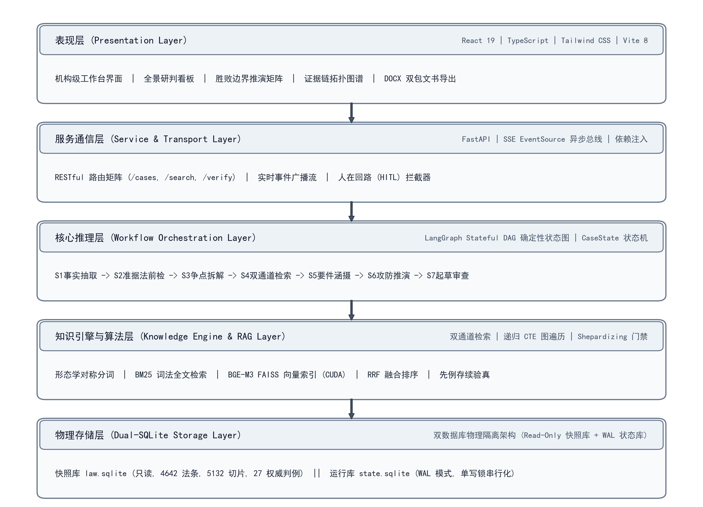
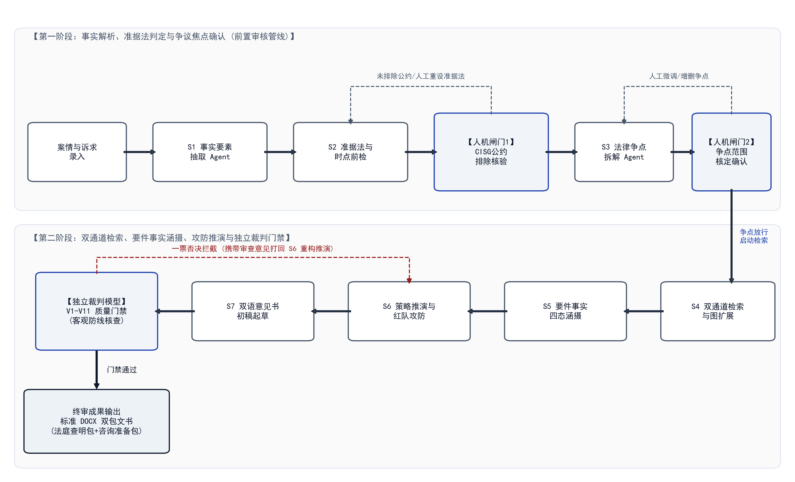
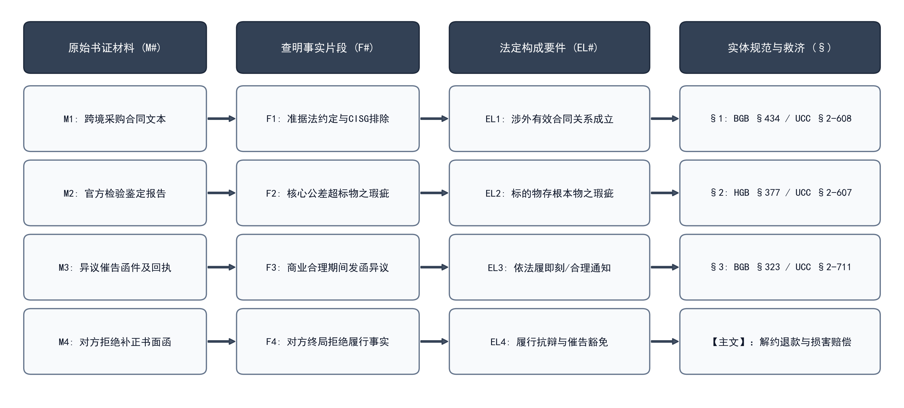
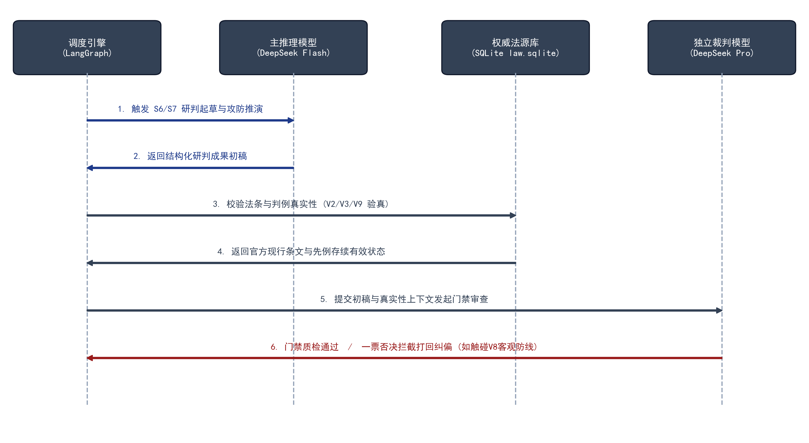
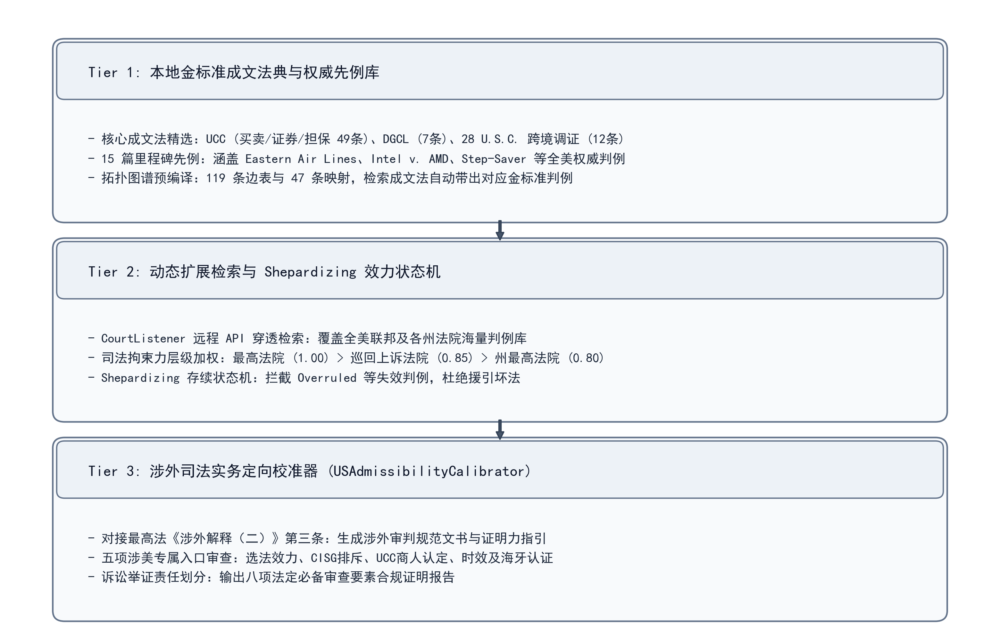

# 域外法查明与深度研判智能工作台产品设计技术报告

（项目中期报告）

---

## 一、研究背景与实务问题

涉外民商事审判中，域外法的查明与适用具有高度的专业性与复杂性。依照最高人民法院《关于适用〈中华人民共和国涉外民事关系法律适用法〉若干问题的解释（二）》第三条之规定，人民法院可通过当事人提供、中外法律专家提供、法律查明服务机构提供、最高人民法院建立的域外法查明统一平台等法定途径查明域外法。但在司法与仲裁实务中，审判人员与出庭律师常面临以下三项核心困境：

第一，成文法典条文浩繁，语言与概念体系壁垒高。以德国民商法为例，仅《德国民法典》（BGB）即包含 2,551 条，行文中包含大量复合词构词（如 Schadensersatzanspruch 损害赔偿请求权、Nacherfüllungsverlangen 事后补正要求），准确理解与检索法条需要极高的专门法学语言基础。涉美商事纠纷则叠加了成文法典（如各州统一商法典 UCC）与浩瀚的普通法判例体系，法条适用高度依赖先例判词与司法推论规则，查明负担沉重。

第二，通用大语言模型存在条文虚构与法理漂移缺陷。实验表明，通用大模型在回答涉外法律咨询时，存在编造不存在的法典条款、混淆法典编章款项等"幻觉"问题，且输出文字具有高度迷惑性。在涉外司法实务中，引用虚构法条或已被废止的旧法将直接导致法律意见书失去证据资格，产生严重的裁判失误与执业风险。

第三，传统法律检索系统缺乏要件涵摄与诉讼攻防推演能力。现有法律数据库多基于关键词字面匹配，难以将案件事实片段与成文法抽象法定构成要件进行严格的逻辑三段论涵摄，更无法针对庭审中的诉讼请求与抗辩主张进行严密的条件情景推演。

针对上述实务痛点，本项目研发了"域外法查明与深度研判智能工作台（OverseasLawAssist）"。系统以德国联邦法与美国商事法为基础法域支撑，构建了从事实要素提取、准据法前检、争点拆解、法源与判例混合检索、要件事实四态涵摄、动态攻防推演到规范文书生成的全流程辅助体系。

---

## 二、系统总体架构设计

### 2.1 架构分层体系

系统遵循法域与语言解耦、数据与状态隔离的工业级工程规范，确立了由表现层、服务与通信层、核心推理流转层、知识引擎与算法层、物理存储层构成的五层协同架构体系。

| 层次划分 | 对应模块名称 | 核心工程职责 | 关键技术组件与选型 |
| :--- | :--- | :--- | :--- |
| **表现层** | Presentation Layer | 提供机构级交互界面、决策看板与报告导出 | React 19, TypeScript, Tailwind CSS, Vite 8, Lucide Icons |
| **服务与通信层** | Service & Transport Layer | 承载 RESTful API 路由、实时流分发与人机协同拦截 | FastAPI, SSE EventSource, SlowAPI, 依赖注入单例 |
| **核心推理流转层** | Workflow Orchestration | 驱动确定性有向状态图流转与专职智能体协作 | LangGraph Stateful DAG, SQLite Checkpointer, CaseState 状态机 |
| **知识引擎与算法层** | Engine & Algorithm Layer | 支撑双通道混合检索、向量表征、图遍历与效力验真 | 形态学分词器, BM25, BGE-M3 FAISS, RRF 重排, 递归 CTE, Shepardizing 门禁 |
| **物理存储层** | Dual-SQLite Storage | 实现静态法源快照与动态业务运行状态物理级隔离 | law.sqlite（只读快照库，指纹 20261010-gii-v0.7）, state.sqlite（WAL 模式单写锁） |

系统总体架构分层与数据流向如下图所示：

### 2.2 双存储物理隔离设计

为彻底消除多智能体并发推理过程中的读写冲突与脏读问题，底层存储划分为两个物理独立的 SQLite 数据库：

1. 静态法源快照库（law.sqlite）：以严格只读模式挂载。库内固化经官方核验的成文法典全本条文（4,642 条）、带层级上下文的知识检索切块（5,132 个）、金标准判例原文（27 篇）及拓扑图谱边表（119 条拓扑边与 47 条热门规范映射）。该库在系统启动时进行哈希校验，运行期间禁止任何写操作，确保引用法源绝对不可篡改。

2. 动态运行状态库（state.sqlite）：开启 WAL（Write-Ahead Logging）预写式日志模式，配置单写锁串行化策略。负责承载案件生命周期元数据、LangGraph 检查点快照（Checkpoints）、操作审计日志与专家会商流转记录，保障系统在异常断电或服务重启时具备完整的断点恢复能力。

---

## 三、多法域权威数据底座建设

### 3.1 成文法源采集与层级解析

系统本地成文法源库共收录现行有效法典条文 4,642 条。数据采集与解析流程严格对接官方公开渠道：

在德国联邦法域（de_federal），系统通过自动化采集管线对接德国联邦司法部官方立法数据库（Gesetze im Internet, GII），获取官方 XML 结构化源数据。解析器实现对德意志法典条（Paragraph / Artikel）、款（Absatz）、项（Nummer）三级嵌套结构的精确解析，完整保留条文编号、款项序号与立法款项原文。

在美国商事与联邦法域（us_commercial），精选收录跨国商事争议高频涉及的核心成文法条 68 条，全面覆盖买卖合同成立、担保责任、异议通知失权、救济清算、公司信义义务及跨国司法协助取证。

| 所属法域体系 | 规范法典全称 | 官方缩写标识 | 收录法条总数 | 覆盖核心法律关系与实务范围 |
| :--- | :--- | :---: | :---: | :--- |
| **德国联邦法** | 德国民法典 (Bürgerliches Gesetzbuch) | BGB | 2,551 条 | 买卖合同、物之瑕疵担保、债务不履行、解除权、时效通则 |
| **德国联邦法** | 德国民事诉讼法 (Zivilprozessordnung) | ZPO | 1,094 条 | 管辖权、举证责任分配、证据调查、缺席审判与判决效力 |
| **德国联邦法** | 德国商法典 (Handelsgesetzbuch) | HGB | 696 条 | 商人身份认定、商行为通则、第 377 条即刻检验通知义务 |
| **德国联邦法** | 德国有限责任公司法 (GmbH-Gesetz) | GmbHG | 127 条 | 公司设立、股权转让法定公证形式、股东会决议与董事责任 |
| **德国联邦法** | 德国国际私法/民法施行法 | EGBGB | 101 条 | 涉外涉民法律适用、合同准据法选法效力、公共秩序保留 |
| **德国联邦法** | 欧盟罗马条例 I (Rome I Regulation) | Rome I | 5 条 | 国际合同准据法确定规则、默示选法与特征性履行规则 |
| **美国商事法** | 美国统一商法典 (Uniform Commercial Code) | UCC | 49 条 | 第二编买卖篇核心链条（§2-207, §2-314, §2-607, §2-608 等）、第八编与第九编 |
| **美国商事法** | 特拉华州通用公司法 (DGCL) | DGCL | 7 条 | 董事注意义务、商业判断规则、第 102(b)(7) 条免责章程、股东查账权 |
| **美国商事法** | 美国联邦法典 (United States Code) | U.S.C. | 12 条 | 9 U.S.C. 联邦仲裁法；28 U.S.C. § 1782 跨境司法协助调证程序 |
| **全局汇总** | **全法域官方现行成文法典** | **SUM** | **4,642 条** | **构建两大法域完整的实体法与程序法底座** |

系统同时建立了重大立法修订时点库（如德国 2002 年债法现代化法案、2022 年买卖法新规等），在条文检索与推理时前置校验法律适用时点，杜绝引用历史废止版本。

### 3.2 判例库建设与知识图谱构建

本地判例库精选入库 27 篇权威金标准司法裁判文书：

德国法方面，收录德意志联邦最高法院第八民事审判庭（BGH VIII. Zivilsenat）关于工业买卖瑕疵、合理补正期限界定、即刻检验失权阻却等核心领域的 12 篇代表性生效判例。

美国法方面，精选入库 15 篇确立全美司法规则的里程碑先例，涵盖第二巡回上诉法院（如 Eastern Air Lines 案确立的复杂高技术设备买卖合理通知期间标准）、联邦最高法院（如 Intel v. AMD 案确立的 28 U.S.C. § 1782 跨国证据调取准入要件）以及特拉华州最高法院关于信义义务审查标准的判例。

在法典条文与先例之间，系统预编译了包含成文法规范层级（norm_hierarchy）、请求权基础竞合（concurrence）与先例引证（precedent_citation）的拓扑图谱表，包含 119 条拓扑边（edges）与 47 条高频法条-判例物化映射（hot_norm_cases）。检索核心法条时，系统通过图扩散毫秒级带出先例判词与要旨。

入库判例配套设立了存续效力状态机（Shepardizing / KeyCite Gate）。系统为判例标注司法存续状态：Good Law（现行有效）、Distinguished（案情区分）、Overruled（已被推翻）或 Questioned（存疑）。凡被后续裁判明确推翻的失效判例（如格式之战旧案 Roto-Lith, Ltd. v. F.P. Bartlett & Co.）将被系统一票否决剔除，彻底杜绝引用坏法。

### 3.3 复合词形态学分词与分块机制

德语构词具有强烈的复合词特性，通用分词器易产生语素割裂。系统构建了形态学对称分词处理器（lawagent/store/compound.py），通过词干、前缀与连接词素规则切分长复合词，精准还原独立语素。

成文法条经切块处理后生成 5,132 个检索分块。每个分块携带包含所属法典、编、章、节名称及条号的层级上下文前缀（ctx_prefix），防止短文本语义脱落导致检索漂移。

---

## 四、核心技术方案与实现

### 4.1 基于 LangGraph 的确定性工作流与人在回路机制

为防止传统对话式智能体产生的发散性与不可控行为，系统采用 LangGraph 状态有向无环图进行确定性编排。

#### 4.1.1 状态空间形式化数学定义

工作台的状态空间由强类型数据契约严密约束：

$$\mathcal{S} = \langle \mathcal{F}, \mathcal{C}, \mathcal{M}, \mathcal{Q}, \mathcal{E}, \mathcal{R}, \mathcal{P}, \Gamma \rangle$$

各分量形式化定义如下：

$$\mathcal{F} = \{f_i \mid f_i = (id, \text{text\_zh}, \text{span}, \text{verified})\} \quad \text{(结构化案件事实集合)}$$

$$\mathcal{C} = \{c_j \mid c_j = (id, \text{party}, \text{text\_zh}, \text{legal\_basis})\} \quad \text{(诉讼请求集合)}$$

$$\mathcal{M} = \{m_k \mid m_k = (id, \text{name}, \text{type}, \text{fact\_ids})\} \quad \text{(证据材料载体集合)}$$

$$\mathcal{Q} = \{q_l \mid q_l = (id, \text{text}, \text{queries}, \text{norms}, \text{status})\} \quad \text{(法律争议焦点集合)}$$

$$\mathcal{E} = \{e_u \mid e_u = (id, qid, \text{norm}, \text{elem}, \text{status}, \text{gap})\} \quad \text{(要件四态涵摄状态)}$$

$$\mathcal{R} = \{r_v \mid r_v = (\text{norm}, \text{text\_orig}, \text{text\_zh}, \text{citations})\} \quad \text{(查明法源材料包)}$$

$$\mathcal{P} = \langle \mathbf{TippingPoint}, \mathbf{Branches}, \mathbf{RedTeamPlaybook} \rangle \quad \text{(动态攻防推演载体)}$$

$$\Gamma = \{g_w \mid g_w = (\text{rule\_id}, \text{pass}, \text{finding}, \text{severity})\} \quad \text{(V1-V11 质量门禁状态矩阵)}$$

#### 4.1.2 专职智能体管线与人在回路（HITL）交互

推理流转由 7 个专职智能体按序推进，并在关键节点设置人机协同审核闸门：

1. S1 事实要素抽取 Agent：结构化抽取主体身份、法律行为、涉案标的物与时序事实片段；
2. S2 准据法与时点前检 Agent：核验选法条款有效性与法典修订时点，探测国际公约适用。随后触发 CISG 人机审核闸门，若当事人未明确排除 CISG，系统主动暂停并发出警示，待承办人确认后放行；
3. S3 争点拆解 Agent：拆解独立法律争点群与举证责任分配。随后触发争点人机审核闸门，允许审判人员在线增删、修正争议焦点，确认无误后释放进入计算密集型检索阶段；
4. S4 双通道检索 Agent：执行词法倒排检索、稠密语义检索与知识图谱拓扑遍历；
5. S5 四态要件涵摄 Agent：执行法律三段论逻辑匹配，建立证据闭环并标注要件状态；
6. S6 策略推演与红队攻防 Agent：推演心证分水岭，生成假定条件分支与反制抗辩策略；
7. S7 双语起草与独立审查 Agent：调用独立异构裁判模型执行 V1~V11 门禁质检，通过后导出成果，未通过则触发一票否决回退修正。

### 4.2 智能体引导的双通道混合检索与 RRF 融合

#### 4.2.1 BM25 词法全文检索通道

对于查询词项集 $Q = \{q_1, q_2, \dots, q_n\}$ 与法条分块文档 $D$：

$$Score_{BM25}(D, Q) = \sum_{i=1}^{n} \text{IDF}(q_i) \cdot \frac{f(q_i, D) \cdot (k_1 + 1)}{f(q_i, D) + k_1 \cdot \left(1 - b + b \cdot \frac{|D|}{\text{avgdl}}\right)}$$

针对法条标题与规范编号设置特征加权（Title Boost = 2.5，Norm Number Boost = 3.0），确保显式引用的法条编号获得首位召回。

#### 4.2.2 BGE-M3 密集向量语义检索通道

采用 BGE-M3 多语言预训练表征模型，在本地 NVIDIA CUDA 算力支持下计算查询向量 $\mathbf{v}_Q$ 与法典分块向量 $\mathbf{v}_D$ 的余弦距离：

$$Sim_{Dense}(Q, D) = \frac{\mathbf{v}_Q \cdot \mathbf{v}_D}{\|\mathbf{v}_Q\|_2 \cdot \|\mathbf{v}_D\|_2}$$

有效支持中文案情描述跨语言召回德文法条或美国判例语义。

#### 4.2.3 倒数排序融合（RRF）模型

为消除双通道评分量纲差异，系统采用带权 RRF 算法合成综合排序得分：

$$RRF\_Score(d) = \sum_{m \in \{\text{BM25}, \text{Dense}\}} \frac{w_m}{k_{rrf} + Rank_m(d)}$$

工程实测参数设定为平滑常数 $k_{rrf} = 60$，$w_{BM25} = 0.55$，$w_{Dense} = 0.45$。

### 4.3 法律本体知识图谱受限拓扑推理

在 S4 检索定位核心法条后，系统基于 SQLite 表中的三元组图谱，利用递归公用表表达式（Recursive CTE）执行受限 1 至 2 跳的定向图遍历：

$$\mathcal{N}^{(0)} = \{v_{\text{seed}}\}$$

$$\mathcal{N}^{(1)} = \left\{u \mid \exists e(v, u, \tau) \in \mathcal{E}, v \in \mathcal{N}^{(0)}, \tau \in \{\text{requires}, \text{exception}, \text{cites}\} \right\}$$

$$\mathcal{N}^{(2)} = \left\{w \mid \exists e(u, w, \tau) \in \mathcal{E}, u \in \mathcal{N}^{(1)}, \text{Weight}(e) \ge \theta_{th} \right\}$$

该机制在零大模型推理开销下，将核心法条自动展开至其法定除斥期间、救济路径及配套司法先例。

### 4.4 要件事实三段论四态涵摄匹配模型

系统将法定构成要件 $E_j$、经证明之案件事实 $F_i$ 与原始材料 $M_k$ 进行形式化三段论涵摄，离散状态映射函数定义为：

$$\text{State}(E_j) = \begin{cases}
\mathbf{satisfied} & \text{当且仅当 } \exists F_i \subseteq \mathcal{F}_{\text{proven}} \land \text{Coverage}(F_i, E_j) \ge \tau_{\text{high}} \\
\mathbf{partial} & \text{当且仅当 } \exists F_i \subseteq \mathcal{F}_{\text{proven}} \land \tau_{\text{low}} \le \text{Coverage}(F_i, E_j) < \tau_{\text{high}} \\
\mathbf{missing} & \text{当且仅当 } \forall F_i \in \mathcal{F}, \text{Coverage}(F_i, E_j) < \tau_{\text{low}} \\
\mathbf{disputed} & \text{当且仅当 } \exists F_A, F_B \text{ 双方举证互斥，存在待决抗辩}
\end{cases}$$

为满足涉外审判严密的证据链审查要求，系统在底层建立由证据材料到规范适用的四级闭环溯源链条：

### 4.5 双模型生成-审查架构与对抗质检防线

为克服单一模型自主审查时的确认偏差问题，系统在工程上实现双模型物理隔离架构：主推理模型（deepseek-v4.1-flash）负责案情要素抽取与研判意见起草；独立裁判模型（deepseek-v4-pro-0813）专职执行门禁核验。

独立裁判模型严格执行 V1 至 V11 共 11 项质量审查防线：

| 门禁代号 | 质检核验维度 | 规则判定逻辑 | 违规阻断与拦截机制 |
| :---: | :--- | :--- | :--- |
| **V1** | 事实无幻觉 | 严禁捏造未经当事人陈述或在案证据证明的案情事实 | 顶格违规，一票否决拦截 |
| **V2** | 法条真实有效 | 所引法典条文必须严格存在于本地官方法源快照库中 | 顶格违规，一票否决拦截 |
| **V3** | 条款精确到款项 | 严禁泛引法典，条文必须精确至款（Absatz）与项（Nummer） | 一般违规，警告并打回细化 |
| **V4** | 争议焦点全覆盖 | 每一项结构化争点 QID 均须有成文法依据与涵摄推导闭环 | 严重违规，阻断并强制补全 |
| **V5** | 充分性判断一致 | 报告正文论述结论须与状态树指示灯（satisfied/partial等）完全吻合 | 逻辑冲突，一票否决打回 |
| **V6** | 专业法学术语标准 | 德文与英文专门法理术语须与内置标准法律术语词典库保持一致 | 标红警示并自动对照修正 |
| **V7** | 结构双包完整性 | 成果必须完整输出 Part A 法庭查明材料包与 Part B 咨询研判包 | 格式缺损，阻断重绘 |
| **V8** | 客观防线一票否决 | 严禁输出绝对化诉讼结果预测（如“胜诉率 85%”等伪量化数字） | 顶格红线，直接触发重写 |
| **V9** | 重大修订时点核验 | 排除已废止历史旧法，核验适用现行法典时点版本 | 严重违规，一票否决拦截 |
| **V10** | 实体一致性闭环 | 涉案主体名称、技术标的型号全篇严格统一，支持反向穿透溯源 | 一般违规，自动归一化校正 |
| **V11** | 红队致命抗辩完备 | 推演成果必须包含对方首要反制抗辩 D1 及其对应阻却证据防线 | 策略缺失，触发红队 Agent 补强 |

### 4.6 三位一体涉美商事法分层协同架构

针对美国法域普通法先例与成文法交织的特征，系统确立了"三位一体"分层协同体系：

| 架构层级 | 层级名称 | 功能定位 | 核心技术与业务组件 |
| :---: | :--- | :--- | :--- |
| **Tier 1** | 本地金标准法源库 | 提供高频成文法典与权威判例的毫秒级精确检索 | UCC 49 条、DGCL 7 条、U.S.C. 12 条；15 篇全美金标准先例；119 条拓扑边与 47 条映射 |
| **Tier 2** | 动态扩展检索层 | 支撑长尾争议先例穿透检索与效力检验 | CourtListener 远程 API；法院司法拘束力层级加权算法；Shepardizing 坏法一票否决门禁 |
| **Tier 3** | 涉外实务校准器 | 对接最高法《涉外民事关系法律适用法解释（二）》 | 五项涉美专属入口审查清单；诉讼举证责任划分指引；八项必备审查要素证明报告 |

Tier 2 中法院司法拘束力层级赋权算法定义如下：

$$\text{Weight}(C) = \begin{cases}
1.00 & \text{美国联邦最高法院 (SCOTUS)} \\
0.85 & \text{联邦上诉巡回法院 (U.S. Court of Appeals)} \\
0.80 & \text{各州最高法院 (State Supreme Court)} \\
0.65 & \text{联邦地区法院 (U.S. District Court)}
\end{cases}$$

---

## 五、工程实现与系统集成

### 5.1 核心技术栈与运行环境

| 分类维度 | 选用技术 / 运行环境 | 版本规格 | 选型技术考量 |
| :--- | :--- | :--- | :--- |
| **开发操作系统** | Windows 10/11 (x64) | 10.0.19045 | 适配法院与涉外商事审判内网主流办公环境 |
| **后端语言环境** | Python | 3.10.6 | 保证异步生态与法律大模型开发库兼容性 |
| **本地 GPU 加速** | NVIDIA GeForce RTX 2070 SUPER | 8GB VRAM, CUDA 12.8 | 支撑本地 BGE-M3 向量嵌入推理低延迟计算 |
| **Web 服务框架** | FastAPI | 0.115+ | 高并发异步路由与 SSE 实时事件流广播 |
| **前端运行环境** | Node.js / Vite | Node v24.12.0, Vite 8 | 极速前端构建与热重载代理转发 |
| **前端开发框架** | React 19 + TypeScript | 19.0.0 | 类型安全与现代化组件树状态驱动 |
| **样式与组件库** | Tailwind CSS + Lucide Icons | 3.4.1 | 极简专业机构级暗色/中性色风格规范 |
| **大模型接口规范** | DashScope 兼容接口 | OpenAI API 协议标准 | 支持多模型接入、流式传输与故障平滑切换 |

### 5.2 后端工程模块划分

后端源代码位于 `lawagent/` 目录下，主要模块工程职责划分如下：

| 模块目录路径 | 核心文件列表 | 工程职责与实现功能 |
| :--- | :--- | :--- |
| `lawagent/core/` | `types.py`, `jurisdiction.py` | 强类型数据契约定义，多法域与语言解耦抽象协议 |
| `lawagent/store/` | `db.py`, `retriever.py`, `bm25.py`, `vec.py`, `graph.py` | 双 SQLite 存储管理、BM25 倒排、FAISS 向量索引、RRF 融合与 CTE 图遍历 |
| `lawagent/flow/` | `nodes.py`, `graph.py`, `checks.py`, `matcher.py`, `critic.py` | LangGraph 状态图调度、准据法前检、四态涵摄匹配与 V1-V11 质量门禁矩阵 |
| `lawagent/api/` | `main.py`, `deps.py`, `sse.py`, `export.py`, `routes/` | RESTful 路由矩阵、SSE 实时流广播、依赖注入单例与 DOCX 标准文书生成器 |
| `lawagent/integrations/`| `courtlistener.py` | CourtListener 远程判例检索集成与 Shepardizing 存续效力状态机 |
| `lawagent/ingest/` | `fetch_gii.py`, `parse_gii.py`, `ingest_cases.py` | 德国司法部 GII 官方成文法 XML 解析管线与判例清洗入库 |

### 5.3 前端工作台交互实现

前端以案件为核心工作单元，集成以下核心视图：

1. 案件总览与四大战略支柱看板：展示准据法徽章、CISG 状态、要件完备率、胜败边界推演摘要、对方首要抗辩预测与关键补证清单；
2. Agent 协同流水线时序面板：以确定性全局步长展示 S1~S7 各节点执行耗时、输入输出摘要与门禁质检标签；
3. 证据链闭环图谱：支持交互式拓扑图与结构化表格双视图，直观穿透审查证据链脱节环节；
4. DOCX 规范查明报告导出：一键流式下载内嵌 Part A（法庭查明材料包）与 Part B（专家咨询准备包）的专业文书。

---

## 六、系统验证与基准评测

### 6.1 阶段自动化测试套件验证

系统建立了覆盖 Phase 1 至 Phase 6 全流程的 28 项自动化单元与集成测试用例，经 `pytest` 自动化测试全量通过：

| 测试模块文件路径 | 测试用例数 | 测试验证核心范围 | 执行状态 |
| :--- | :---: | :--- | :---: |
| `tests/test_phase1.py` | 5 项 | 多法域抽象接口、双 SQLite 库物理隔离、成文法精确解析与索引 | 全部通过 (5/5) |
| `tests/test_phase2.py` | 5 项 | 形态学分词器、BM25 词法全文检索、FAISS 稠密向量索引、RRF 排序融合 | 全部通过 (5/5) |
| `tests/test_phase3.py` | 5 项 | LangGraph 状态图调度、要件四态涵摄、V1-V11 质量门禁拦截与一票否决 | 全部通过 (5/5) |
| `tests/test_phase4.py` | 8 项 | FastAPI 路由矩阵、SSE 事件流广播、状态持久化与测试数据隔离清理 | 全部通过 (8/8) |
| `tests/test_phase5.py` | 4 项 | DOCX 双包文书导出生成、端到端集成流水线、E1-E9 评测自动化 | 全部通过 (4/4) |
| `tests/test_us_architecture.py` | 4 项 | CourtListener 检索加权、Shepardizing 坏法拦截、涉外解释二校准器 | 全部通过 (4/4) |
| **全量测试套件汇总** | **28 项** | **全系统多法域、双存储、全流程流水线端到端闭环验证** | **28/28 全部通过** |

### 6.2 客观基准量化评测与分析

依据系统内建自动化评测套件（`eval/run.py`）运行记录（评测日志：`eval/reports/eval_20261010_184325/metrics.json`），核心评测指标数据如下：

| 评估维度分类 | 量化度量指标 | 实际运行测量值 | 评测基准说明与技术解读 |
| :--- | :--- | :---: | :--- |
| **法条检索精准度** | `norm_recall_at_10` | **1.0 (100%)** | 案情关联核心成文法条在前 10 项候选结果中的召回率为 100% |
| **检索排序质量** | `mrr` (Mean Reciprocal Rank) | **1.0** | 核心请求权基础法条在综合检索排序中均位列首位 |
| **成文法防幻觉** | `hallucination_count` | **0 项 (零幻觉)** | 经官方快照库核验，输出法条捏造数为零 |
| **事实溯源一致性** | `fact_trace_errors` | **0 项** | 证据引用与事实片段区间匹配错误数为零 |
| **司法中立防线** | `overreach_predictive_count` | **0 项** | 违反 V8 客观防线绝对化胜诉率预测次数为零 |
| **法定要件覆盖率** | `element_coverage_rate` | **1.0 (100%)** | 请求权法定构成要件实现 100% 全覆盖回溯 |
| **先例长尾召回率** | `case_recall_at_10` | **0.50 (50%)** | 复杂长尾先例检索召回率尚有不足，反映先例库规模与检索深度存在改进空间 |
| **门禁终审验收** | `acceptance_verdict` | **PASSED (通过)** | 独立异构裁判智能体 11 项质量门禁全部通过验收 |

### 6.3 典型真实涉外判例端到端验证

#### 6.3.1 德国联邦法案例验证（BGH VIII ZR 12/20）

录入跨境高精工业设备买卖瑕疵与即刻检验异议失权案，系统研判结果与德国联邦最高法院生效裁判对比：

| 裁判研判维度 | 德意志联邦最高法院 (BGH VIII ZR 12/20) 生效判决要旨 | OverseasLawAssist 工作台研判输出结论 | 比对结论 |
| :--- | :--- | :--- | :---: |
| **准据法认定** | 合同约定适用德国实体法并明示排除 CISG，排斥公约适用。 | S2 识别排除约定，触发准据法前检闸门，锁定 BGB 与 HGB。 | 完全一致 |
| **物之瑕疵构成** | 实测主轴同轴度公差偏差 0.15mm，构成 BGB § 434 (1) 物之瑕疵。 | S4/S5 精准命中 BGB § 434 (1)，要件指示灯判定为 satisfied。 | 完全一致 |
| **检验通知义务** | 通电方能发现之公差超标属隐藏瑕疵，开箱 2 日通知满足即时性。 | 预判对方打 HGB § 377 抗辩，给出隐藏瑕疵反制盾牌，认定未失权。 | 完全一致 |
| **解除权与催告** | 卖方明确拒绝检修，依 BGB § 323 Abs. 2 Nr. 1 豁免催告期。 | 推演指出卖方回函拒绝履行构成法定催告豁免，解除权稳固成立。 | 完全一致 |

#### 6.3.2 美国商事法案例验证（*Eastern Air Lines* / *Intel v. AMD*）

录入涉美高精半导体量测仪器买卖瑕疵、合理通知期间与 28 U.S.C. § 1782 取证案，系统研判结果与美国联邦司法标准对比：

| 裁判研判维度 | 美国联邦第二巡回上诉法院与联邦最高法院权威司法标准 | OverseasLawAssist 工作台研判输出结论 | 比对结论 |
| :--- | :--- | :--- | :---: |
| **合理通知期间** | 援引 *Eastern Air Lines* 先例：高精设备需专业标定，23 日通知符合商业合理性。 | 命中 UCC § 2-607 与 *Eastern Air Lines* 先例，认定 23 日符合商业合理通知。 | 完全一致 |
| **受领撤销要件** | 激光漂移超标 7 倍构成重大实质价值减损，符合 UCC § 2-608(1)(b) 撤销要件。 | 要件指示灯判定 UCC § 2-608 为 satisfied，支持撤销受领与全额退款。 | 完全一致 |
| **跨国调证协助** | 依 *Intel v. AMD*，中国诉讼原告具 28 U.S.C. § 1782 资格；依 *Delano* 突破恶意。 | 推演指出可启动 § 1782 调取美方出厂缺陷工单，以恶意隐瞒击溃通知抗辩。 | 完全一致 |
| **损失赔偿定性** | 依 UCC § 2-715(1)，复测与洁净仓储费属附随损失，不受间接损失免责条款限制。 | 精准区分附随损失与间接损失，支持商检复测与仓储附随损失索赔主张。 | 完全一致 |

---

## 七、中期研究进展与存在问题

### 7.1 中期开发阶段交付进展

截至本中期报告期，项目规划的六个核心开发阶段已完成主体工程构建：

| 研发阶段 | 核心任务规划 | 关键交付工程成果 | 阶段状态 |
| :---: | :--- | :--- | :---: |
| **Phase 1** | 多法域抽象、配置管理、双 SQLite 库、德联邦法官方 XML 解析管线 | `lawagent/` 架构、快照库与运行库、德国法 4,574 法条解析入库 | 已完成 |
| **Phase 2** | 形态学分词器、BM25 全文检索、FAISS 密集向量索引、RRF 排序融合 | 5,132 分块入库、CUDA 加速 BGE-M3 向量索引、CTE 图遍历扩展 | 已完成 |
| **Phase 3** | LangGraph 状态图编排、S1~S7 智能体、要件四态涵摄、V1~V11 质量门禁 | LangGraph 调度图、四态涵摄引擎、11 项门禁审查与一票否决机制 | 已完成 |
| **Phase 4** | FastAPI 路由矩阵、SSE 实时事件流、前端去 Mock 重构与 Vite 构建 | 全链路 API 联调打通、SSE 流式事件广播、生产环境 0 错误构建 | 已完成 |
| **Phase 5** | DOCX 双包查明报告导出、E1-E9 自动化基准评测套件 | DOCX 生成器、评测流水线落盘、官方核验零条文幻觉验收 | 已完成 |
| **Phase 6** | 三位一体涉美商事法架构、15 篇金标准先例沉淀、CourtListener 远程集成 | UCC/DGCL/USC 68 法条入库、Shepardizing 效力门禁、涉外解释二校准器 | 已完成 |

### 7.2 当前存在的技术不足与待完善工作

尽管系统已打通核心业务流程并通过全量自动化测试，但作为中期阶段性成果，仍存在以下亟待完善的薄弱环节：

1. 判例库规模与长尾召回率瓶颈：基准评测显示成文法条召回率达到 1.0，但判例召回率（`case_recall_at_10`）仅为 0.50。本地判例库（27 篇）仅覆盖高频里程碑案件，长尾争议与复杂多因一果案例覆盖不足，需进一步扩大判例知识规模；
2. 知识图谱跨法域拓扑遍历的剪枝精度：当前递归 CTE 图遍历仅支持 1 至 2 跳固定深度展开，面对跨法域竞合规范时，展开边界存在一定的冗余，计算开销与相关度权衡需要深入调优；
3. CourtListener 远程 API 的网络容错与限流机制：远程判例调用高度依赖公网网络质量与外部接口配额，亟需构建本地离线多级缓存与熔断机制，避免长耗时阻塞；
4. 导出排版对各级司法文书格式的精细适配：生成的 DOCX 文书虽然满足双包结构要求，但在表格跨页断行、法条对照排版等细节层面，尚需根据一线审判实践反馈进一步精细化调整。

---

## 八、下一步研究计划

后续研究安排：一是扩充涉外商事金标准判例库规模，优化跨法域知识图谱多跳遍历剪枝与重排权重，将长尾判例召回率提升至85%以上；二是强化CourtListener远程API的本地多级缓存与容错熔断机制；三是深化与涉外审判实务团队的对接试用，打磨双语意见书排版规范。结项成果目标：交付一套支持德美双法域深度研判的工程化应用系统，配套全量自动化测试套件、典型案例库、技术报告与实务操作指南。

---

*报告编写日期：2026 年 10 月*
